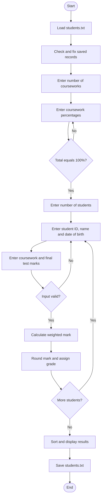

# Student Grade Management System

A Python-based student grade management application designed for teachers. The program collects student information and assessment marks, calculates weighted results, assigns grades, and stores records in a text file so they can be loaded and used again later.

## Features

- **Persistent student records** – loads previously saved student data from `students.txt` and saves updated records when the program finishes.
- **Saved-record validation and repair** – checks existing records and attempts to correct invalid or inconsistent data, including student IDs, names, dates of birth, and overall marks.
- **Flexible coursework weighting** – allows the teacher to choose the number of coursework components and enter the percentage weight for each one. The total weighting must equal 100%.
- **Student data input** – collects each student's ID, first name, surname, date of birth, coursework marks, and final test mark.
- **Input validation** – checks user input before accepting it, helping prevent invalid student information and marks from entering the results.
- **Weighted mark calculation** – calculates each student's overall mark using the configured assessment percentages.
- **Grade assignment** – rounds the calculated mark according to the program's rounding settings and assigns the corresponding grade category.
- **Results table** – sorts and displays the results in a readable table using the `tabulate` library.

## How It Works

1. The program loads `students.txt`.
2. Previously saved records are checked and corrected where possible.
3. The teacher enters the number of coursework components.
4. The teacher assigns a percentage weight to each component. The total must equal 100%.
5. The teacher enters how many students will be processed.
6. For each student, the program collects personal details and assessment marks.
7. The input is validated. If the data is invalid, the program asks for the relevant information again.
8. The program calculates the weighted mark, rounds it, and assigns a grade.
9. Once all students have been entered, the program sorts and displays the results.
10. The updated student records are saved to `students.txt`.

## Program Flowchart

The flowchart below describes the main program workflow.



## Data Validation and Record Handling

The program includes validation and correction logic for both newly entered and previously saved data.

- **Student ID:** uses a two-digit format (`00`–`99`). The program checks available IDs and can assign the nearest free ID when repairing a saved record.
- **Names:** removes invalid characters and formats names using capitalization. A name with no usable characters is treated as invalid.
- **Date of birth:** validates and normalizes dates to the `YYYY-MM-DD` format. The program also calculates the student's age.
- **Marks:** checks assessment input and ensures that marks are within the accepted range.
- **Coursework percentages:** checks that the combined weighting is exactly 100%.
- **Saved records:** checks loaded student records and prepares messages describing corrections made.

## Data Storage

Student records are stored locally in:

```text
students.txt
```

At startup, the program loads existing records. At the end of a run, it saves the updated records back to the same file. This allows student information to be reused between program runs.

## Technologies Used

- **Python** – application logic, input handling, validation, calculations, and file operations.
- **Tabulate** – formatting student results as a readable table.
- **Text file storage** – saving and loading student records through `students.txt`.

## Running the Project

1. Make sure Python is installed.
2. Install the required table-formatting library:

   ```bash
   pip install tabulate
   ```

3. Open the project folder in a terminal.
4. Run the main Python file:

   ```bash
   python coursework.py
   ```


## Project Purpose

This project was developed as a practical tool for teachers to manage student assessment results. It brings together file handling, data validation, loops, functions, calculations, sorting, and formatted output in one application.

